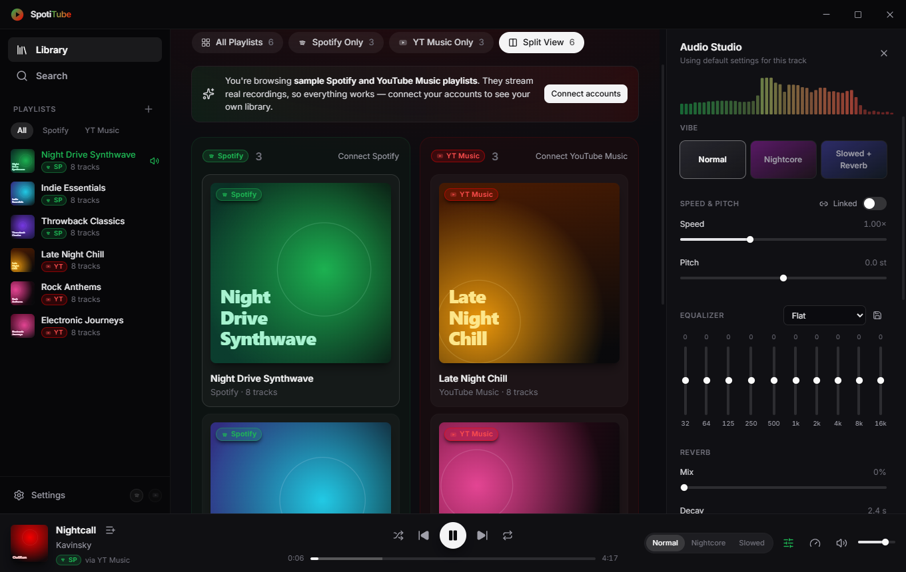
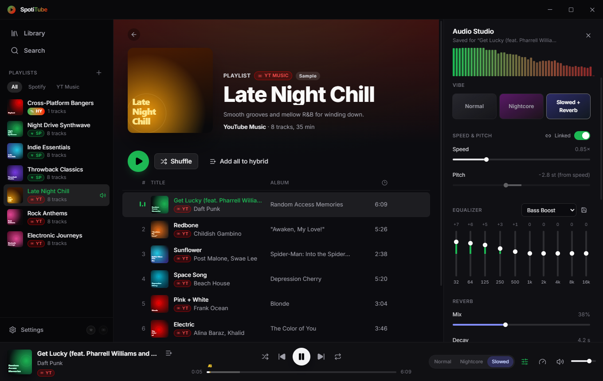

<p align="center">
  
</p>

<h1 align="center">SpotiTube</h1>

<p align="center">
  One desktop player for <b>Spotify</b> and <b>YouTube Music</b> — with a real-time DSP studio.<br/>
  Electron · React 19 · TypeScript · Web Audio API
</p>


## Features

- **Unified library** — Spotify and YouTube Music playlists in one view, every card, sidebar item and track row
  colour-badged by source (Spotify green, YT Music red, Hybrid gradient). Filter tabs: **All**, **Spotify only**,
  **YT Music only** and **Split view** (both catalogs in parallel columns).
- **Hybrid playlists** — mix tracks from both services into local SpotiTube playlists.
- **Side-by-side search** across both catalogs.
- **Plays everything through YouTube Music** — Spotify tracks are matched to the best YouTube Music upload
  automatically; the **stream source picker** lets you swap to a live, remix, slowed or other version and pin it.
  See [How playback works](#how-playback-works) for the two playback modes.
- **Audio Studio** (real-time Web Audio DSP, available with direct streams):
  - speed 0.5–2.0× — time-stretched, or *linked* tape-style where pitch follows speed
  - independent pitch shift ±12 semitones (AudioWorklet)
  - 10-band EQ with built-in presets (Flat, Bass Boost, Vocal, Electronic, …) and your own
  - convolution reverb with a generated impulse (mix, decay, pre-delay, damping)
  - one-click **Nightcore** and **Slowed + Reverb**
  - **A-B looping**, pre-amp and a brickwall limiter
  - **per-track memory**: EQ, speed, pitch, reverb and loop points are remembered for every track
- **Desktop integration** — frameless window with native controls (Windows) or inset traffic lights (macOS), media
  keys, OS media overlay (MediaSession), system tray with transport controls, optional close-to-tray.
- **Works out of the box** — sample Spotify and YouTube Music playlists stream real recordings before you connect any
  account; a built-in synthesizer covers the case where no stream can be resolved (e.g. offline).

| Split view | Audio Studio |
| --- | --- |
|  |  |

## Getting started

**Requirements:** Node.js 22.12+ (24 LTS recommended) and npm. Windows 10/11 or macOS 12+ for running the app.

```bash
git clone https://github.com/Roguu2/SpotiTube.git
cd SpotiTube
npm install
npm run dev
```

> **npm 12+:** install scripts are blocked unless allow-listed. `package.json` already allows `electron` (which
> downloads its binary on install) and `electron-winstaller`. If you upgrade Electron and `npm run dev` reports a
> missing binary, run `npm install-scripts approve electron`.

### Scripts

| Command | What it does |
| --- | --- |
| `npm run dev` | Start the app with hot reload (renderer) and auto-restart (main/preload) |
| `npm run build` | Type-check main, preload and renderer, then bundle to `out/` |
| `npm start` | Run the production bundle from `out/` |
| `npm run build:win` | Build and package a Windows NSIS installer into `release/<version>/` |
| `npm run build:mac` | Build and package a universal macOS `.dmg` (must run on macOS) |
| `npm run build:unpack` | Build and package without an installer (quick local check) |
| `npm run icon` | Regenerate `build/icon.png` from `scripts/generate-icon.mjs` |

## Connecting your accounts

Open **Settings** (gear icon in the sidebar, or `Ctrl/Cmd + ,`).

### Spotify

SpotiTube uses the Authorization Code flow with **PKCE**, so you only need a client ID — no secret.

1. Go to the [Spotify Developer Dashboard](https://developer.spotify.com/dashboard) and create an app.
2. Select **Web API** as the API used.
3. Add the redirect URI `http://127.0.0.1:43821/callback` (also shown, with a copy button, in Settings).
4. Copy the app's **Client ID** into SpotiTube and press **Connect Spotify**. Your browser opens for consent.

Apps in Spotify's *development mode* only work for users added under **User Management** in the dashboard — add
the Spotify account you sign in with.

Spotify provides the catalog, playlists and metadata. Audio always comes from YouTube Music, because Spotify does
not offer full-track streams to third-party apps.

### YouTube Music

Search, public playlists and streaming work without signing in. To load **your** library and Liked Music:

1. Open [music.youtube.com](https://music.youtube.com) in your browser, signed in.
2. Press `F12` → **Network**, reload, and click any request named `browse`.
3. Under **Request Headers**, copy the whole value of `cookie`.
4. Paste it into Settings → YouTube Music and press **Connect**.

The cookie must contain `SAPISID` / `__Secure-3PAPISID`. If YouTube signs you out of that browser session, reconnect
with a fresh cookie.

## How playback works

Spotify does not offer full-track audio to third-party apps, so every track is played from YouTube Music. SpotiTube
picks one of two modes per track, automatically:

| Mode | When | What you get |
| --- | --- | --- |
| **Direct stream** | YouTube serves the complete audio stream | Full Audio Studio: EQ, pitch, reverb, Nightcore / Slowed, spectrum |
| **YouTube player** | YouTube serves only part of the stream | Complete playback through YouTube's official embedded player, shown in a mini-player. Speed, volume, seeking, A-B loops and version selection work; EQ, pitch and reverb are paused |

YouTube currently serves only the first ~1 MB (about a minute) of a direct stream to apps without a proof-of-origin
token. SpotiTube does not try to generate such tokens or otherwise get around YouTube's protections. It checks once
whether complete streams are available and otherwise uses the official player, so tracks always play to the end
instead of going silent. If a direct stream is cut off mid-song, playback continues in the official player at the
same position.

Your DSP settings are kept per track and apply again whenever a direct stream is available.

### Optional: yt-dlp

When the built-in extraction via [YouTube.js](https://github.com/LuanRT/YouTube.js) fails outright, SpotiTube can use
[yt-dlp](https://github.com/yt-dlp/yt-dlp) if it is installed on your `PATH` or configured in Settings.

## Keyboard shortcuts

| Keys | Action |
| --- | --- |
| `Space` | Play / pause |
| `←` / `→` | Seek −5 s / +5 s |
| `Ctrl/Cmd + ←` / `→` | Previous / next track |
| `↑` / `↓` | Volume up / down |
| `M` | Mute |
| `Ctrl/Cmd + F` | Search |
| `Ctrl/Cmd + E` | Toggle Audio Studio |
| `Ctrl/Cmd + ,` | Settings |

Double-click any slider in the Audio Studio to reset it.

## Releases and CI

Two GitHub Actions workflows build on `windows-latest` and `macos-latest`:

- **`build.yml`** — on every push to `main` and on pull requests: type-check, bundle, package, and upload the
  `.exe` and `.dmg` as workflow artifacts (kept 14 days).
- **`release.yml`** — on a `v*` tag: builds both installers and publishes them to the public
  [SpotiTube-releases](https://github.com/Roguu2/SpotiTube-releases/releases) repository. The source repo stays
  private; the public repo only holds installers and the update feed.

The release goes live automatically, but only after both platform builds succeed and every file is uploaded;
otherwise it stays a draft. Release notes are generated from the commits since the previous tag.

**One-time setup:** create a [fine-grained personal access token](https://github.com/settings/personal-access-tokens/new)
with access to **only** `Roguu2/SpotiTube-releases` and the permission **Contents: Read and write**. Then store it in
this repo as the `RELEASES_TOKEN` secret:

```bash
gh secret set RELEASES_TOKEN --repo Roguu2/SpotiTube
```

To cut a release:

```bash
npm version patch
```

```bash
git push --follow-tags
```

Installed apps pick it up within hours, or immediately via **Settings → Updates → Check for updates**.

### In-app updates

Installed builds update themselves from GitHub Releases (`electron-updater`):

- **Checks:** SpotiTube checks 15 s after launch and every 4 hours. You can also check any time in
  **Settings → Updates**.
- **Download:** with **Automatic updates** on (the default), a new version downloads in the background. When it's
  ready, a **Restart to update** card appears in the sidebar. Restarting installs silently and relaunches the app;
  otherwise the update installs the next time SpotiTube quits.
- **Feed:** updates come from the published releases in the public `SpotiTube-releases` repo, through the
  `latest.yml` / `latest-mac.yml` files the release workflow uploads. Drafts are ignored.
- **macOS:** automatic installation only works for code-signed builds. Unsigned macOS builds report the update and
  link to the download page instead.

Installers are **not code-signed**. Windows SmartScreen will warn on first run (**More info → Run anyway**). On
macOS, right-click the app and choose **Open** the first time, or run `xattr -cr /Applications/SpotiTube.app`. To
sign, add `CSC_LINK` / `CSC_KEY_PASSWORD` (and Apple notarization credentials) as repository secrets and remove
`CSC_IDENTITY_AUTO_DISCOVERY: false` from the workflows.

## Architecture

```
┌──────────────────────────── Main process (Node) ─────────────────────────────┐
│  ProviderRegistry ── SpotifyProvider ── SpotifyAuth (PKCE, loopback :43821)  │
│        │          ├─ YouTubeMusicProvider ── YouTubeClient (youtubei.js)     │
│        │          ├─ HybridProvider (local playlists)                        │
│        │          └─ DemoProvider (sample library)                           │
│        ├─ TrackMatcher ─ scores YT Music candidates for non-YT tracks        │
│        ├─ StreamResolver ─ YTMUSIC → IOS → MWEB clients → yt-dlp, cached     │
│        └─ StreamProxy ─ 127.0.0.1:<random>, CORS + byte ranges, auto-refresh │
│  electron-store (settings, encrypted secrets, hybrid playlists, DSP profiles)│
│  Tray · media keys · window controls                                         │
└───────────────▲──────────────────────────────────────────────────────────────┘
                │ typed IPC (contextBridge → window.electronAPI)
┌───────────────┴──────────── Renderer (React) ────────────────────────────────┐
│  Zustand: useLibraryStore · usePlayerStore · useAudioEngineStore ·           │
│           useSettingsStore                                                   │
│  AudioEngine (Web Audio graph, below)                                        │
└──────────────────────────────────────────────────────────────────────────────┘

<audio> → preamp → 10-band EQ → pitch worklet ─┬─ dry ──────────────┬→ limiter → volume → analyser → out
                                               └─ convolver → wet ──┘
```

```
electron/
  main/            app lifecycle, window, tray, IPC handlers
    providers/     spotify/, ytmusic/, hybrid/, demo/ — IMusicProvider implementations
    services/      stream resolver, track matcher, stream proxy, stores, synth
  preload/         contextBridge API (sandboxed, CommonJS)
src/
  core/            shared types, IPC contract, DSP model — no Node or DOM APIs
  audio/           AudioEngine, reverb impulse generator, pitch-shifter worklet
  store/           Zustand stores
  components/      layout, library, player, studio, settings, ui primitives
  providers/       renderer-side source metadata (labels, colours)
```

### Adding a music source

Every source implements `IMusicProvider` from [`src/core/types.ts`](src/core/types.ts):

```ts
interface IMusicProvider {
  getPlaylists(): Promise<UnifiedPlaylist[]>
  getPlaylistTracks(playlistId: string): Promise<UnifiedTrack[]>
  searchTracks(query: string): Promise<UnifiedTrack[]>
  resolveStreamUrl(track: UnifiedTrack): Promise<string>
}
```

To add one (SoundCloud, local FLAC/MP3, …):

1. Add its id to `ProviderId` / `SourceId`.
2. Implement the interface under `electron/main/providers/<name>/`.
3. Register it in `ProviderRegistry`.
4. Add badge colours in [`src/providers/sources.ts`](src/providers/sources.ts).

`resolveStreamUrl` may return any `https:` URL; the stream proxy handles range requests, CORS and URL expiry.

### Security

- **Renderer isolation:** the renderer runs sandboxed with context isolation and no Node integration.
- **IPC:** every handler validates its input and rejects senders other than the app's own pages.
- **Secrets:** the Spotify refresh token and the YouTube cookie are encrypted with the OS keychain (DPAPI, Keychain or
  libsecret) through Electron `safeStorage`.
- **YouTube player code:** the signature deciphering code runs in an isolated `vm` context with a timeout.
- **Stream proxy:** it binds to `127.0.0.1`, serves only randomly-named streams it has registered, and rejects
  requests with a foreign `Host` header.

## Data locations

Everything is stored locally in the app's user-data directory:

| OS | Path |
| --- | --- |
| Windows | `%APPDATA%\SpotiTube\` |
| macOS | `~/Library/Application Support/SpotiTube/` |

`spotitube.json` holds settings, encrypted secrets, hybrid playlists and pinned stream sources. `dsp-profiles.json`
holds per-track audio settings and custom EQ presets. Deleting the folder resets the app.

## Troubleshooting

| Problem | Fix |
| --- | --- |
| *“INVALID_CLIENT: Invalid redirect URI”* | The dashboard redirect URI must be exactly `http://127.0.0.1:43821/callback`. |
| *“Port 43821 is in use”* | Another app holds the OAuth callback port; close it and retry. |
| Spotify connects but shows no playlists | Add your account under **User Management** in the Spotify dashboard (development mode). |
| A track plays the *synth preview* | No matching upload was found. Pick a version in **Audio Studio → Stream source**. |
| EQ / pitch / reverb are greyed out | The track is playing through the official YouTube player; see [How playback works](#how-playback-works). |
| “Uploader does not allow this video in other apps” | SpotiTube tries other uploads automatically; you can also pick one in **Stream source**. |
| Wrong version auto-matched | Choose the right one in **Stream source**; it is pinned for that track from then on. |

## Disclaimer

SpotiTube is an independent, unofficial project for personal use. It is not affiliated with, endorsed by or
sponsored by Spotify or YouTube/Google. It streams audio through unofficial YouTube interfaces, which may conflict
with YouTube's Terms of Service and can break whenever YouTube changes them. Use it at your own discretion.
