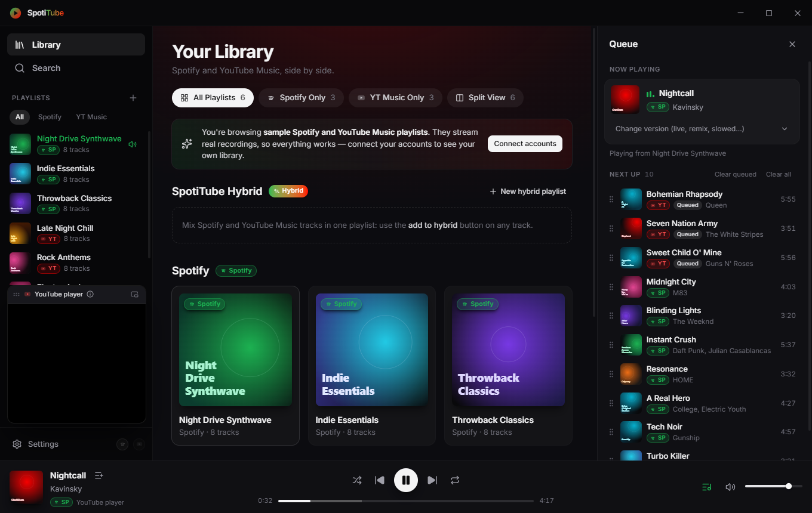
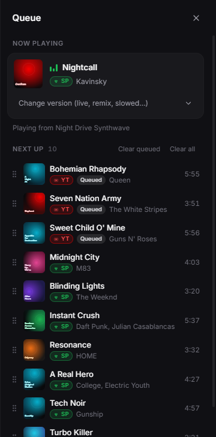

<p align="center">
  
</p>

<h1 align="center">SpotiTube</h1>

<p align="center">
  <b>All your music in one simple player: your Spotify playlists and YouTube Music, side by side.</b><br/>
  Free, no ads, no account of its own.
</p>

<p align="center">
  <a href="https://github.com/Roguu2/SpotiTube/releases/latest"></a>
  <a href="https://github.com/Roguu2/SpotiTube/releases"></a>
  
</p>

<p align="center">
  <a href="https://github.com/Roguu2/SpotiTube/releases/latest"><b>⬇ Windows</b></a>
  &nbsp;·&nbsp;
  <a href="https://github.com/Roguu2/SpotiTube/releases/latest"><b>⬇ macOS</b></a>
  &nbsp;·&nbsp;
  <a href="https://github.com/Roguu2/SpotiTube/releases/latest"><b>⬇ Linux</b></a>
</p>



Your playlists live in two apps. SpotiTube brings them into **one window**, so you can listen to everything without
switching back and forth. Pick a song, line up what comes next, discover something new, or just let it play.
It works straight away with sample playlists, and you can connect your own accounts whenever you like.

## What you can do

<table>
  <tr>
    <td width="50%" valign="top">
      <h3>🎧 Everything in one place</h3>
      Spotify and YouTube Music playlists side by side, one search for both, and your own mixed playlists with songs
      from either service.
    </td>
    <td width="50%" valign="top">
      <h3>📋 You decide what's next</h3>
      Queue songs, reorder them by dragging, and when the queue runs out SpotiTube keeps going with music like what you
      just heard. Start a radio from any song.
    </td>
  </tr>
  <tr>
    <td width="50%" valign="top">
      <h3>✨ Find something new</h3>
      Not sure what to play? <b>Discover</b> picks a playlist for your mood (chill, party, workout…) or favourite genre.
      Open any album or artist with one click.
    </td>
    <td width="50%" valign="top">
      <h3>🎤 Sing along</h3>
      Full-screen <b>Now playing</b> with lyrics that follow the song, line by line. Click a line to jump there.
    </td>
  </tr>
  <tr>
    <td width="50%" valign="top">
      <h3>🛋️ Cozy mode</h3>
      A calm, warm full-screen view with a big clock and the current lyric: perfect on a second screen or in the
      background while you work or relax.
    </td>
    <td width="50%" valign="top">
      <h3>🪟 Small when you need it</h3>
      Shrink SpotiTube into a tiny always-on-top player, control it from the taskbar or your keyboard's media keys, and
      set a sleep timer for the evening.
    </td>
  </tr>
  <tr>
    <td width="50%" valign="top">
      <h3>❤️ Likes that follow you</h3>
      Heart a song to keep it in <b>Liked songs</b>, and on Spotify or YouTube Music too when your account is connected.
    </td>
    <td width="50%" valign="top">
      <h3>💻 On all your computers</h3>
      Windows, macOS and Linux. Optionally keep your playlists in your YouTube Music account, so every computer, and
      the YouTube Music app on your phone, has them. Updates install themselves.
    </td>
  </tr>
</table>

| Spotify and YouTube Music side by side | Mixed playlists | Your queue |
| --- | --- | --- |
|  |  |  |

<details>
<summary><b>Every feature, in detail</b></summary>

- **Unified library** — Spotify and YouTube Music playlists in one view, each playlist badged by where it comes
  from (Spotify green, YT Music red, Hybrid gradient). Filter tabs: **All**, **Spotify only**,
  **YT Music only** and **Split view** (both catalogs in parallel columns).
- **Likes** — the heart in the player bar, Now playing and the mini player saves songs to a **Liked songs** playlist
  (it syncs like any hybrid playlist) and, when the account is connected, to Spotify's Liked Songs or your YouTube
  Music likes. Spotify accounts connected before 0.4 need to reconnect once to allow it.
- **Hybrid playlists** — mix tracks from both services into local SpotiTube playlists.
- **Side-by-side search** across both catalogs. Playing a result starts a radio: that song, then music like it.
- **Sync through your YouTube Music account** — with YouTube Music connected, turn on *Sync playlists with this
  account* in Settings: your SpotiTube playlists (and Liked songs) are kept as private playlists in that account, so
  every computer signed in to it, and the YouTube Music apps, have them. Additions, removals, renames and deletions on
  either side are merged; Spotify tracks travel as the YouTube upload SpotiTube plays for them.
- **Plays everything through YouTube Music** — Spotify tracks are matched to the best YouTube Music upload
  automatically; **Change version** (in the queue) swaps to a live, remix, slowed or other version and pins it.
  If YouTube won't play an upload here (Premium-only, region-locked, removed), SpotiTube switches to another upload
  of the same song on its own and remembers to skip that one next time. See [How playback works](#how-playback-works).
- **Queue** — see what's playing and what's next; **Play next** / **Add to queue** on any track (right-click or ⋯),
  drag & drop or `Alt+↑/↓` to reorder, remove, clear, or jump to any entry. Queued tracks play before the rest of the
  playlist, and shuffle leaves them in place.
- **Albums & artists** — click an album or artist name in any song list, the player bar or Now playing: album
  pages list every track (play, shuffle, queue or save as a playlist); artist pages show top songs, albums, singles
  and artists like them, with Play and Radio. They come from YouTube Music for every source, no sign-in needed.
- **Discover** — not sure what to play? **Surprise me** picks a random playlist from any of YouTube Music's moods
  (Chill, Party, Workout…) or genres (Hip-hop, Rock, Jazz…) and plays it shuffled; or pick a mood or genre and choose
  one of its playlists. Like one? Save it to your library. Leans local (e.g. Polish rap in Poland).
- **Now playing & synced lyrics** — click the cover in the player bar (or `Ctrl/Cmd + L`) for a full-screen view
  over a backdrop made from the album art, with time-synced lyrics from [LRCLIB](https://lrclib.net) that follow the
  song. Click a line to jump there; nudge the sync if a version's timing differs.
- **Song notifications** — optionally, a quiet system notification with the cover when a new song starts while
  SpotiTube is in the background (Settings).
- **Discord status** — optionally show *Listening to SpotiTube* with the song, artist, cover, a progress bar and an
  *Open on Spotify / YouTube Music* button on your Discord profile (Settings; Discord must be running).
- **Cozy mode** — a calm full-screen view for a second monitor (`Ctrl/Cmd + Shift + C` or the sofa button): the
  cover over a slowly drifting backdrop, a big clock, the current lyric line and what's next. Controls and the cursor
  fade away when the mouse rests; it lays itself out vertically on a portrait screen. `Esc` leaves fullscreen, then
  cozy mode.
- **Mini player** — shrink the window into a small always-on-top player (`Ctrl/Cmd + Shift + M` or the
  picture-in-picture button): compact (square video and the essentials) or larger with every control. YouTube's
  player stands in for the cover. It remembers where you put it and which size you like.
- **Autoplay & radio** — when the queue runs out, SpotiTube keeps going with similar tracks (shown as *Autoplay* at the
  end of the queue, so anything you queue still plays first; switch it off in the queue or in Settings).
  **Start radio** on any track builds an endless mix around it.
- **Find & sort in playlists** — filter a playlist by title, artist or album (`Ctrl/Cmd + F`) and sort it by title,
  artist, album or length; the sort is remembered per playlist.
- **Smooth fades** — skipping, pausing and resuming fade the music briefly instead of cutting it off (Settings).
- **Sleep timer** — the moon button in the player bar stops playback after 15–90 minutes or at the end of the track.
- **Recently played** — every track you listen to for 30 s or more (or half of a shorter one), grouped by day, with
  **Jump back in** cards for the playlists you played from. Clear it any time in Settings.
- **Resume where you left off** — the queue, shuffle/repeat and the playing track come back on launch, paused at the
  same spot. Drag the seek bar before pressing play to start somewhere else. Can be turned off in Settings. The window
  size and position and the last open view are restored too.
- **Start with Windows** (or at login on macOS), from Settings.
- **Desktop integration** — frameless window with native controls (Windows) or inset traffic lights (macOS);
  previous / play-pause / next buttons on the **taskbar thumbnail** (Windows) or in the **Dock menu** (macOS); the
  current song in the window title; media keys, OS media overlay (MediaSession), tray controls, optional close-to-tray.
- **Works out of the box** — sample Spotify and YouTube Music playlists stream real recordings before you connect any
  account; a built-in synthesizer covers the case where no stream can be resolved (e.g. offline).

</details>

## Get started

1. **Download** the installer for your computer from the [latest release](https://github.com/Roguu2/SpotiTube/releases/latest):
   - **Windows 10/11:** `SpotiTube-<version>-Setup.exe`
   - **macOS 12+** (Intel and Apple Silicon): `SpotiTube-<version>-universal.dmg`
   - **Linux:** `SpotiTube-<version>-x86_64.AppImage` (any distribution) or `SpotiTube-<version>-amd64.deb`
     (Ubuntu, Debian and friends)
2. **Install and open it.** Sample playlists are ready to play straight away, no account needed.
3. **Connect your accounts** in **Settings** (whenever you want) to see your own playlists:
   - **YouTube Music:** search and playback work without an account. To load your own playlists and likes, paste a
     cookie from your signed-in browser; SpotiTube shows you where to find it.
   - **Spotify:** create a free app in the [Spotify Developer Dashboard](https://developer.spotify.com/dashboard)
     and add your Spotify account under **User Management**, then paste the app's Client ID in Settings and click
     **Connect**. Spotify Premium isn't needed. [Step-by-step guide](#spotify)

> The installers aren't code-signed yet, so your computer may ask once whether to trust them:
> - **Windows:** SmartScreen → **More info** → **Run anyway**.
> - **macOS:** right-click the app → **Open**, then **Open** again.
> - **Linux (AppImage):** make the file executable (right-click → Properties, or `chmod +x`), then open it.

## FAQ

<details>
<summary><b>Is it free?</b></summary>

Yes. SpotiTube is free, with no ads and no account of its own.
</details>

<details>
<summary><b>Do I need Spotify Premium?</b></summary>

No. Spotify provides your playlists and song details; the music itself plays from YouTube Music, because Spotify
doesn't let other apps stream full songs.
</details>

<details>
<summary><b>Where does the music come from?</b></summary>

From YouTube Music. Each Spotify song is matched to the best YouTube Music version automatically: same song, same
artist, same length, and no covers or remixes unless you ask for one. You can always pick a different version, and if
a version won't play, SpotiTube switches to another one on its own.
</details>

<details>
<summary><b>Why is there a small YouTube player?</b></summary>

YouTube currently doesn't let apps stream complete songs directly, so SpotiTube plays them through YouTube's official
player, which never cuts out. YouTube requires that player to stay visible, but you can make it small, move it to any
corner or dock it in the sidebar. SpotiTube doesn't try to get around YouTube's protections.
</details>

<details>
<summary><b>What happens to my data?</b></summary>

Everything stays on your computer. Your Spotify login and YouTube Music cookie are encrypted with your system's
keychain and only ever sent to Spotify and YouTube. SpotiTube has no servers and collects no analytics. If you turn on
playlist sync, your SpotiTube playlists are stored as private playlists in your own YouTube Music account.
</details>

<details>
<summary><b>How do updates work?</b></summary>

SpotiTube checks for new versions, downloads them in the background and offers **Restart to update**. You can also
check any time in **Settings → Updates**. On macOS, automatic installation needs a signed build; until then the app
links you to the new download instead.
</details>

<details>
<summary><b>Something doesn't play or sounds wrong.</b></summary>

Open the **queue** and use **Change version** under the playing song to pick another one; SpotiTube remembers your
choice. If a problem persists, please [open an issue](https://github.com/Roguu2/SpotiTube/issues).
</details>

## Keyboard shortcuts

| Keys | Action |
| --- | --- |
| `Space` | Play / pause |
| `←` / `→` | Seek −5 s / +5 s |
| `Ctrl/Cmd + ←` / `→` | Previous / next song |
| `↑` / `↓` | Volume up / down |
| `M` | Mute |
| `Ctrl/Cmd + F` | Find in the open playlist, otherwise Search |
| `Ctrl/Cmd + E` | Show or hide the queue |
| `Ctrl/Cmd + L` | Now playing & lyrics (`Esc` closes) |
| `Ctrl/Cmd + Shift + M` | Mini player on / off |
| `Ctrl/Cmd + Shift + C` | Cozy mode on / off |
| `Ctrl/Cmd + ,` | Settings |

---

## For developers

SpotiTube is built with Electron, React 19 and TypeScript.

### Build from source

**Requirements:** Node.js 22.12+ (24 LTS recommended) and npm.

```bash
git clone https://github.com/Roguu2/SpotiTube.git
cd SpotiTube
npm install
npm run dev
```

> **npm 12+:** install scripts are blocked unless allow-listed. `package.json` already allows `electron` (which
> downloads its binary on install) and `electron-winstaller`. If you upgrade Electron and `npm run dev` reports a
> missing binary, run `npm install-scripts approve electron`.

#### Scripts

| Command | What it does |
| --- | --- |
| `npm run dev` | Start the app with hot reload (renderer) and auto-restart (main/preload) |
| `npm run build` | Type-check main, preload and renderer, then bundle to `out/` |
| `npm start` | Run the production bundle from `out/` |
| `npm run build:win` | Build and package a Windows NSIS installer into `release/<version>/` |
| `npm run build:mac` | Build and package a universal macOS `.dmg` (must run on macOS) |
| `npm run build:linux` | Build a Linux `.AppImage` and `.deb` (run on Linux) |
| `npm run build:unpack` | Build and package without an installer (quick local check) |
| `npm run icon` | Regenerate `build/icon.png` from `scripts/generate-icon.mjs` |

### Connecting your accounts

Open **Settings** (gear icon in the sidebar, or `Ctrl/Cmd + ,`).

#### Spotify

SpotiTube uses the Authorization Code flow with **PKCE**, so you only need a client ID — no secret.

1. Go to the [Spotify Developer Dashboard](https://developer.spotify.com/dashboard) and create an app.
2. Select **Web API** as the API used.
3. Add the redirect URI `http://127.0.0.1:43821/callback` (also shown, with a copy button, in Settings).
4. Copy the app's **Client ID** into SpotiTube and press **Connect Spotify**. Your browser opens for consent.

Apps in Spotify's *development mode* only work for users added under **User Management** in the dashboard — add
the Spotify account you sign in with.

Spotify provides the catalog, playlists and metadata. Audio always comes from YouTube Music, because Spotify does
not offer full-track streams to third-party apps.

#### YouTube Music

Search, public playlists and streaming work without signing in. To load **your** library and Liked Music:

1. Open [music.youtube.com](https://music.youtube.com) in your browser, signed in.
2. Press `F12` → **Network**, reload, and click any request named `browse`.
3. Under **Request Headers**, copy the whole value of `cookie`.
4. Paste it into Settings → YouTube Music and press **Connect**.

The cookie must contain `SAPISID` / `__Secure-3PAPISID`. If YouTube signs you out of that browser session, reconnect
with a fresh cookie.

### How playback works

Spotify does not offer full-track audio to third-party apps, so every track is played from YouTube Music. SpotiTube
picks one of two modes per track, automatically:

| Mode | When | What you get |
| --- | --- | --- |
| **Direct stream** | YouTube serves the complete audio stream | Played locally through the Web Audio engine (no visible player) |
| **YouTube player** | YouTube serves only part of the stream | Complete playback through YouTube's official embedded player, shown in a mini-player you can make compact, move to any corner or dock in the sidebar |

YouTube currently serves only the first ~1 MB (about a minute) of a direct stream to apps without a proof-of-origin
token. SpotiTube does not try to generate such tokens or otherwise get around YouTube's protections. It checks once
whether complete streams are available and otherwise uses the official player, so tracks always play to the end
instead of going silent. If a direct stream is cut off mid-song, playback continues in the official player at the
same position.

#### Optional: yt-dlp

When the built-in extraction via [YouTube.js](https://github.com/LuanRT/YouTube.js) fails outright, SpotiTube can use
[yt-dlp](https://github.com/yt-dlp/yt-dlp) if it is installed on your `PATH` or configured in Settings.

### Releases and CI

Two GitHub Actions workflows build on `windows-latest`, `macos-15-intel` and `ubuntu-latest`:

- **`build.yml`** — on every push to `main` and on pull requests: type-check, bundle and package the Linux
  `.AppImage` and `.deb`. Run it by hand (*Actions → Build → Run workflow*) to also get the `.exe` and `.dmg`.
  Installers are kept as workflow artifacts for 14 days.
- **`release.yml`** — on a `v*` tag: builds every installer and publishes them as a release of this repository,
  which is also the update feed. It uses the built-in `GITHUB_TOKEN`, so no secrets are needed.

The release goes live automatically, but only after every platform build succeeds and every file is uploaded;
otherwise it stays a draft. Release notes are generated from the commits since the previous tag.

To cut a release:

```bash
npm version patch
```

```bash
git push --follow-tags
```

Installed apps pick it up within hours, or immediately via **Settings → Updates → Check for updates**.

> **Moving from the old releases repo.** Up to 0.7.0, installers and the update feed lived in
> [SpotiTube-releases](https://github.com/Roguu2/SpotiTube-releases/releases), and those installs still look there.
> While the `RELEASES_TOKEN` secret (a fine-grained token with *Contents: Read and write* on that repo) exists,
> `release.yml` also copies each release there, so they update to a version that reads from this repo. Once
> everyone is on 0.7.1 or newer, delete the secret and archive that repo.

#### In-app updates

Installed builds update themselves from this repository's releases (`electron-updater`):

- **Checks:** 15 s after launch and every 4 hours, sooner again after a failed check. You can also check any time in
  **Settings → Updates**.
- **Download:** with **Automatic updates** on (the default), a new version downloads in the background. When it's
  ready, a **Restart to update** card appears in the sidebar. Restarting installs silently and relaunches the app;
  otherwise the update installs the next time SpotiTube quits.
- **Feed:** the `latest.yml` / `latest-mac.yml` / `latest-linux.yml` files of the latest published release; drafts
  are ignored. If github.com answers with a server error, SpotiTube reads the same files through GitHub's API.
- **macOS:** automatic installation only works for code-signed builds. Unsigned macOS builds report the update and
  link to the download page instead.

Installers are **not code-signed**. To sign, add `CSC_LINK` / `CSC_KEY_PASSWORD` (and Apple notarization
credentials) as repository secrets and remove `CSC_IDENTITY_AUTO_DISCOVERY: false` from the workflows.

### Architecture

```
┌──────────────────────────── Main process (Node) ─────────────────────────────┐
│  ProviderRegistry ── SpotifyProvider ── SpotifyAuth (PKCE, loopback :43821)  │
│        │          ├─ YouTubeMusicProvider ── YouTubeClient (youtubei.js)     │
│        │          ├─ HybridProvider (local playlists)                        │
│        │          └─ DemoProvider (sample library)                           │
│        ├─ TrackMatcher ─ scores YT Music candidates for non-YT tracks        │
│        ├─ StreamResolver ─ YTMUSIC → IOS → MWEB clients → yt-dlp, cached     │
│        └─ StreamProxy ─ 127.0.0.1:<random>, CORS + byte ranges, auto-refresh │
│  electron-store (settings, secrets, hybrid playlists, history, DSP profiles) │
│  Tray · media keys · window controls                                         │
└───────────────▲──────────────────────────────────────────────────────────────┘
                │ typed IPC (contextBridge → window.electronAPI)
┌───────────────┴──────────── Renderer (React) ────────────────────────────────┐
│  Zustand: useLibraryStore · usePlayerStore · useAudioEngineStore ·           │
│           useSettingsStore · useHistoryStore                                 │
│  AudioEngine (Web Audio graph, below)                                        │
└──────────────────────────────────────────────────────────────────────────────┘

<audio> → preamp → 10-band EQ → pitch worklet ─┬─ dry ──────────────┬→ limiter → volume → analyser → out
                                               └─ convolver → wet ──┘
```

```
electron/
  main/            app lifecycle, window, tray, IPC handlers
    providers/     spotify/, ytmusic/, hybrid/, demo/ — IMusicProvider implementations
    services/      stream resolver, track matcher, stream proxy, stores, synth
  preload/         contextBridge API (sandboxed, CommonJS)
src/
  core/            shared types, IPC contract, DSP model — no Node or DOM APIs
  audio/           AudioEngine, reverb impulse generator, pitch-shifter worklet
  store/           Zustand stores
  components/      layout, library, player, studio, settings, ui primitives
  providers/       renderer-side source metadata (labels, colours)
```

#### Adding a music source

Every source implements `IMusicProvider` from [`src/core/types.ts`](src/core/types.ts):

```ts
interface IMusicProvider {
  getPlaylists(): Promise<UnifiedPlaylist[]>
  getPlaylistTracks(playlistId: string): Promise<UnifiedTrack[]>
  searchTracks(query: string): Promise<UnifiedTrack[]>
  resolveStreamUrl(track: UnifiedTrack): Promise<string>
}
```

To add one (SoundCloud, local FLAC/MP3, …):

1. Add its id to `ProviderId` / `SourceId`.
2. Implement the interface under `electron/main/providers/<name>/`.
3. Register it in `ProviderRegistry`.
4. Add badge colours in [`src/providers/sources.ts`](src/providers/sources.ts).

`resolveStreamUrl` may return any `https:` URL; the stream proxy handles range requests, CORS and URL expiry.

#### Security

- **Renderer isolation:** the renderer runs sandboxed with context isolation and no Node integration.
- **IPC:** every handler validates its input and rejects senders other than the app's own pages.
- **Secrets:** the Spotify refresh token and the YouTube cookie are encrypted with the OS keychain (DPAPI, Keychain or
  libsecret) through Electron `safeStorage`.
- **YouTube player code:** the signature deciphering code runs in an isolated `vm` context with a timeout.
- **Stream proxy:** it binds to `127.0.0.1`, serves only randomly-named streams it has registered, and rejects
  requests with a foreign `Host` header.

### Data locations

Everything is stored locally in the app's user-data directory:

| OS | Path |
| --- | --- |
| Windows | `%APPDATA%\SpotiTube\` |
| macOS | `~/Library/Application Support/SpotiTube/` |
| Linux | `~/.config/SpotiTube/` |

`spotitube.json` holds settings, encrypted secrets, hybrid playlists and pinned stream sources. `history.json` holds
up to 500 recent plays, `session.json` the saved queue, `window-state.json` the window size and position and
`ytmusic-sync.json` the state of playlist sync. Deleting the folder resets the app.

### Troubleshooting

| Problem | Fix |
| --- | --- |
| *“INVALID_CLIENT: Invalid redirect URI”* | The dashboard redirect URI must be exactly `http://127.0.0.1:43821/callback`. |
| *“Port 43821 is in use”* | Another app holds the OAuth callback port; close it and retry. |
| Spotify connects but shows no playlists | Add your account under **User Management** in the Spotify dashboard (development mode). |
| A track plays the *synth preview* | No matching upload was found. Open the queue and use **Change version** under the playing track. |
| “Uploader does not allow this video in other apps” | SpotiTube tries other uploads automatically; you can also pick one with **Change version** in the queue. |
| Wrong version auto-matched | Use **Change version** in the queue; your choice is pinned for that track from then on. |

## Disclaimer

SpotiTube is an independent, unofficial project for personal use. It is not affiliated with, endorsed by or
sponsored by Spotify or YouTube/Google; Spotify and YouTube Music are trademarks of their respective owners. It plays
audio through YouTube services, which may conflict with YouTube's Terms of Service and can change at any time. Use it
at your own discretion.
